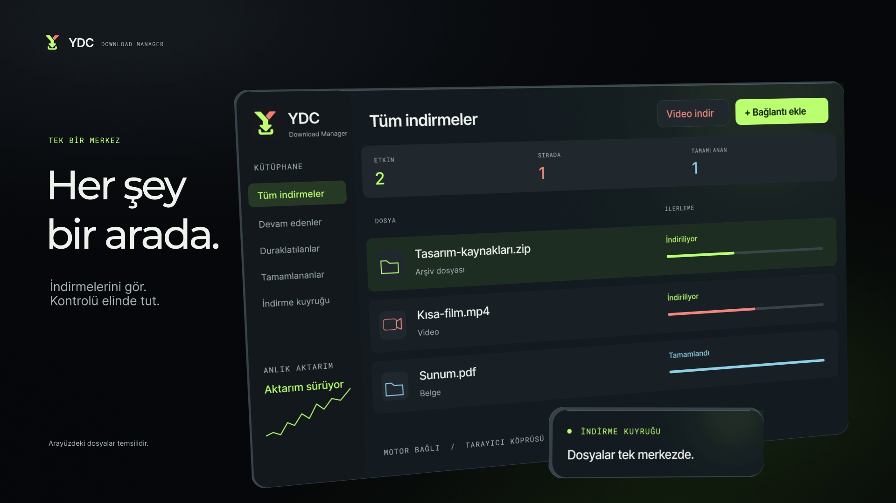

  

<h1 align="center">YDC Download Manager</h1>

<strong>A focused Windows workspace for files, video and audio.</strong> Bring your downloads together, choose your media format and stay in control of every transfer.

  <a href="https://github.com/yunusdenizcingoz/YDC_Download-Manager/releases/latest/download/YDC.DownloadManager-win-Setup.exe"><strong>Download for Windows</strong></a>
  &nbsp; · &nbsp;
  <a href="#product-film">Watch the product film</a>
  &nbsp; · &nbsp;
  <a href="#getting-started">Get started</a>
  &nbsp; · &nbsp;
  <a href="https://github.com/yunusdenizcingoz/YDC_Download-Manager/issues">Support & feedback</a>

Windows 11 x64 · Chrome & Edge · MP4 & MP3 · Turkish application interface Current release: <a href="https://github.com/yunusdenizcingoz/YDC_Download-Manager/releases/latest">0.7.10</a> · Under active development

---

## Product film

**See YDC in 30 seconds.** A closer look at the download workspace, browser handoff, media formats and transfer controls.

https://github.com/user-attachments/assets/f9902608-df4e-4c22-ad13-031e3a37b5bb

**[▶ Watch or download the film · 1080p · 30 seconds](https://github.com/user-attachments/assets/f9902608-df4e-4c22-ad13-031e3a37b5bb)**

The film uses Turkish on-screen text. The illustrations below come from the film; sample file names and progress values are for demonstration.

## One place for your downloads

YDC is a desktop download manager built for Windows. It combines direct file transfers, supported online video downloads and browser integration in a single dark interface. Track progress, manage the queue, pause a transfer and return to it later without juggling separate tools.

| What you want to do | How YDC helps |
| --- | --- |
| **Keep transfers organized** | A central library with search, status filters, progress indicators and quick access to downloaded files. |
| **Download directly from your browser** | Chrome and Edge integration can hand off eligible file downloads and provide controls for supported videos and images. |
| **Choose video or audio** | Inspect a supported video link, select an available MP4 quality or save an MP3 audio output. |
| **Control the queue** | Set concurrent downloads, defer a job with **Download later**, change its priority and reorder waiting jobs. |
| **Manage bandwidth** | Apply a shared speed limit across file and video transfers, with changes reflected while downloads are running. |
| **Pick up where you left off** | Pause and resume supported transfers, keep download history between sessions and use recovery tools when a source changes. |

### A workspace that stays readable

View active, paused, completed and queued downloads at a glance. The interface combines a graphite background with lime, coral and ice-blue accents to make states easier to distinguish. An activity graph and queue counters keep transfer information close at hand.

- Search by file name or host and filter downloads by status.
- Open a completed file or reveal it in its folder from the download row.
- Automatically sort new downloads into folders for video, programs, documents, archives, music and images.
- Keep YDC running in the notification area and adjust interface animations in Settings.

### From the browser to your queue

Use the companion extension in **Google Chrome or Microsoft Edge** to send eligible downloads to YDC. Review the file name and destination before starting, or add the transfer for later.

For supported media, the extension can show an unobtrusive download icon on video players and supported social-media images. Video controls list the qualities found in the source. Image downloads use the largest accessible source; they do not upscale or artificially enhance the picture.

You can also right-click a supported link or image, paste a URL into the extension, or inspect media on the active page.

### Your media, your format

Add a video or supported page URL, let YDC inspect the source, then choose the output. Available options depend on the source rather than a fixed list of promised resolutions.

| Output | Use it for |
| --- | --- |
| **MP4 video** | Save a supported video using a quality actually offered by its source. |
| **MP3 audio** | Create an audio-only output from a supported video. |
| **Direct files** | Download accessible HTTP/HTTPS files, including documents, archives, applications and images. |

Supported workflows include individual YouTube videos and Shorts, selected videos on compatible pages, and accessible HLS/DASH streams. When a page offers several videos, choose the one you want.

### Set the pace

Pause and continue a transfer, prioritize a waiting job, or limit total bandwidth when you need room for other activity. Download history and queue preferences are retained between sessions.

If a download encounters an expired URL or a stalled source, the recovery controls can inspect the job or accept an updated link. YDC validates compatible source information before reusing partial data. Resume and recovery depend on the source and server; they cannot be guaranteed for every link.

## Getting started

### 1. Install YDC

1. **[Download the Windows installer](https://github.com/yunusdenizcingoz/YDC_Download-Manager/releases/latest/download/YDC.DownloadManager-win-Setup.exe)** from the latest release.
2. Run `YDC.DownloadManager-win-Setup.exe` and open YDC from its shortcut.
3. Review your download folder in **Settings** (`Ayarlar`).

The Windows package includes its .NET runtime and download/media tools. A separate .NET, Python or FFmpeg installation is not required. Use an NTFS destination for downloads.

### 2. Add a file or video

- **File:** select **Add link** (`Bağlantı ekle`), paste an accessible HTTP/HTTPS URL, check the destination and start the download.
- **Video or audio:** select **Download video** (`Video indir`), paste a supported URL and inspect it with the search icon. Choose an available quality or **Audio / MP3** (`Ses / MP3`).
- **Later:** select **Download later** (`Sonra indir`) to save a job without starting it immediately. Use **Resume** (`Devam et`) when you are ready.

### 3. Connect Chrome or Edge

The browser extension is currently installed manually; it is not listed in the Chrome Web Store or Edge Add-ons store.

1. Open **Browser connection** (`Tarayıcı bağlantısı`) in YDC and choose **Open extension folder** (`Eklenti klasörünü aç`).
2. In Chrome, open `chrome://extensions`. In Edge, open `edge://extensions`.
3. Enable **Developer mode**, choose **Load unpacked**, and select the YDC `extension` folder containing `manifest.json`.
4. Return to YDC's browser connection screen and register the connection if prompted. Keep the prefilled extension identity.
5. Open the extension and confirm that **YDC connected** (`YDC bağlı`) is shown. Review the automatic handoff and media-button preferences.

Install the extension separately in each browser you want to use. After updating it, reload the extension and refresh existing media tabs when needed.

## Updates that fit your workflow

Installer-based installations check GitHub Releases at startup and approximately once an hour while YDC is running. You can also select **Check for updates** (`Güncellemeleri denetle`) from the sidebar.

When a newer stable version is available, YDC downloads the validated update in the background. Exit YDC from the notification area to apply the pending installation; the next launch uses the new version. Download history and settings stay in the same data folder. Browser extensions may still need to be reloaded separately.

**[View release notes and all downloads →](https://github.com/yunusdenizcingoz/YDC_Download-Manager/releases)**

## Requirements & compatibility

| Area | Current support |
| --- | --- |
| Operating system | Windows 11, 64-bit |
| Application language | Turkish; this product page is in English |
| Browser integration | Google Chrome and Microsoft Edge, with the unpacked extension installed |
| Download destination | Writable NTFS folder with sufficient free space |
| Direct transfers | Accessible HTTP/HTTPS file URLs; segmented transfers when supported by the server |
| Video and audio | Supported, accessible sources; quality and format availability vary |

## Frequently asked questions

<strong>Can I download from every website?</strong>

No. Direct file URLs must be accessible, and media support depends on the source and its extractor. Some JavaScript players, inaccessible frames, expired links and browser-generated downloads cannot be handled. Supported-site behavior can change over time.

<strong>Does YDC support protected videos or full playlists?</strong>

There is no general support for DRM-protected or login-required media. Current YouTube support targets individual videos and Shorts; channel downloads, full playlists and ongoing live streams are outside the current scope. Use YDC for content you own or have permission to download.

<strong>Will every browser download be transferred automatically?</strong>

No. Automatic handoff targets eligible HTTP/HTTPS GET downloads. POST-generated archives, blob/data downloads, private browsing, browser-flagged downloads and requests with an unknown method stay in the browser. A manually pasted sharing-page link is not necessarily the same as the browser's actual file-download URL.

<strong>What happens if a transfer is interrupted?</strong>

YDC stores history and partial-download information locally. On reopening, unfinished jobs are shown as paused. Resume is available when the source can be validated. For an expired or changed source, use the recovery or link-refresh controls. A changed or unverified file is not assumed to be compatible with existing partial data.

<strong>Why is a media button or quality option missing?</strong>

Check that the extension is connected and that its media-button preferences and site access are enabled. Reload the extension and refresh the page after an update. Start playback and scan again if the video loads late. Resolution choices only appear when the source provides them; a direct MP4 may offer only one quality.

<strong>How does browser handoff handle session information?</strong>

Eligible file handoff may use request-specific headers needed for that transfer. The extension does not read the browser's cookie database or browsing-history database. Desktop session context and signed download URLs are protected with Windows CurrentUser DPAPI. General browser sessions are not automatically applied to manually added URLs or the video engine, and automatic cookie refresh is not available.

<strong>Are Firefox, macOS or scheduled downloads supported?</strong>

The current package targets Windows 11 x64 and Chromium-based Chrome/Edge integration. Firefox, macOS, download scheduling, named multiple queues and bulk playlist downloads are not part of the current release.

## Feedback & support

Found an issue or have an idea? **[Open an issue](https://github.com/yunusdenizcingoz/YDC_Download-Manager/issues/new)** and include the YDC version, browser and extension version if relevant, the steps to reproduce the behavior, and the exact error message. Include a public sample URL when possible, and remove private tokens or session information from reports.

YDC uses C#/.NET and WPF for the desktop application, aria2 for supported direct transfers, SQLite for local history, and yt-dlp, FFmpeg and Deno for media workflows. Third-party components retain their respective licenses; consult the notices supplied with the distribution.

---

<strong>Files. Video. Audio. One place.</strong> <a href="https://github.com/yunusdenizcingoz/YDC_Download-Manager/releases/latest/download/YDC.DownloadManager-win-Setup.exe">Get YDC for Windows</a> &nbsp; · &nbsp; <a href="https://github.com/yunusdenizcingoz/YDC_Download-Manager/releases">Release notes</a> &nbsp; · &nbsp; <a href="#product-film">Watch the film</a>

